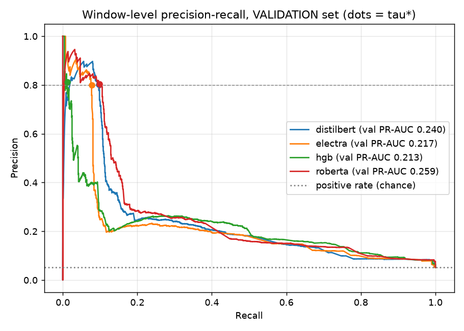

# Model comparison (v2)

All numbers below were produced by `v2/evaluate.py`. Thresholds and gate parameters were tuned on the **validation** set only; every metric in the tables is on the held-out **test** set unless marked `val`.

**Selection rule:** highest val PR-AUC; tiebreak (within 0.01): higher val incident precision, then faster inference.

**Selected model: `roberta`** - highest val PR-AUC (0.2586); no other model within 0.01.

## Window-level metrics (TEST, at each model's tau*)

A window is positive (*pre-fault*) when it contains no alert line but an alert occurs within the next 100 lines. tau* = the lowest threshold whose val precision >= 0.8 (i.e. the highest val recall at that precision). Test positive rate (chance precision): 0.028.

| Model | val PR-AUC | tau* | Precision | Recall | F1 | F0.5 | PR-AUC | ROC-AUC | TP | FP | FN | TN |
|---|---|---|---|---|---|---|---|---|---|---|---|---|
| distilbert | 0.240 | 0.9733 | 0.946 | 0.170 | 0.288 | 0.494 | 0.378 | 0.859 | 212 | 12 | 1038 | 42862 |
| electra | 0.217 | 0.9524 | 0.954 | 0.150 | 0.259 | 0.460 | 0.431 | 0.855 | 187 | 9 | 1063 | 42865 |
| hgb | 0.213 | 0.9990 | 1.000 | 0.012 | 0.024 | 0.057 | 0.363 | 0.911 | 15 | 0 | 1235 | 42874 |
| roberta | 0.259 | 0.9302 | 0.964 | 0.303 | 0.461 | 0.672 | 0.473 | 0.867 | 379 | 14 | 871 | 42860 |
| v1 distilbert (reported; template-ID input, 80/20 split, tau=0.5) | - | - | 0.193 | 0.649 | 0.297 | - | - | - | - | - | - | - |

The v1 row is the figure reported for v1 (its own 80/20 split, threshold 0.5); it was not re-measured here.

## Episode-level (incident) metrics (TEST)

These are **not** window metrics. The daemon gate (tau*, N consecutive windows, cooldown in windows) is replayed over the whole test stream, including windows that contain alerts. Fault episode = run of alert lines, merged when fewer than 100 lines apart. An incident counts as *predictive* only if an episode **starts** within the next 100 lines; incidents fired once an episode is already under way are counted as *late* and are **not** credited. Incident precision = predictive / fired. Lead time is capped by construction at the time spanned by 100 lines.

| Model | N | Cooldown | Incidents fired | Predictive | Late (in-episode) | False | Incident precision | Episodes preceded | Episodes | Episode recall | Lead median (s) | Lead Q1 (s) | Lead Q3 (s) |
|---|---|---|---|---|---|---|---|---|---|---|---|---|---|
| distilbert | 2 | 30 | 52 | 30 | 17 | 5 | 0.577 | 30 | 218 | 0.138 | 11.0 | 8.2 | 12.0 |
| electra | 1 | 0 | 115 | 52 | 58 | 5 | 0.452 | 51 | 218 | 0.234 | 12.0 | 9.5 | 14.0 |
| hgb | 1 | 5 | 17 | 12 | 5 | 0 | 0.706 | 12 | 218 | 0.055 | 12.0 | 12.0 | 13.2 |
| roberta | 1 | 0 | 105 | 36 | 62 | 7 | 0.343 | 35 | 218 | 0.161 | 12.0 | 8.5 | 13.0 |

N and cooldown were chosen on val to maximise incident precision subject to episode recall >= 0.5; **no (N, cooldown) setting reached that recall floor on val for: distilbert, electra, hgb, roberta**, so those fall back to the setting with the best F0.5 of (incident precision, episode recall).

## Cost

| Model | Train (min) | Peak VRAM (MB) | Inference (ms/window) |
|---|---|---|---|
| distilbert | 24.2 | 4220 | 8.5 |
| electra | 33.1 | 3578 | 14.3 |
| hgb | 0.9 | 0 | 1.4 |
| roberta | 47.5 | 3803 | 14.0 |

Inference is single-window latency through `detector.py` from raw log lines (transformers on the GPU).

## Precision targets

- Window-level test precision >= 0.5 at recall >= 0.40: **MISSED** (`roberta`: precision 0.964, recall 0.303; v1 reported 0.193 / 0.649). The precision part is met; the recall part is not, because the operating point is precision-first (the lowest threshold whose val precision >= 0.8 (i.e. the highest val recall at that precision)).
- Incident-level test precision >= 0.8: **MISSED** (`roberta`: 0.343, episode recall 0.161).

What was tried: template-string rendering with run-length encoding instead of v1's bare template IDs (max_length 512), a 200-line ambiguity buffer on train negatives, overlapping train windows (stride 10), 10:1 negative downsampling, a chronological 70/10/20 split with precision-first threshold tuning on val, three model families, and a val-tuned gate. See `ablation.md` for the measured effect of each data lever.

