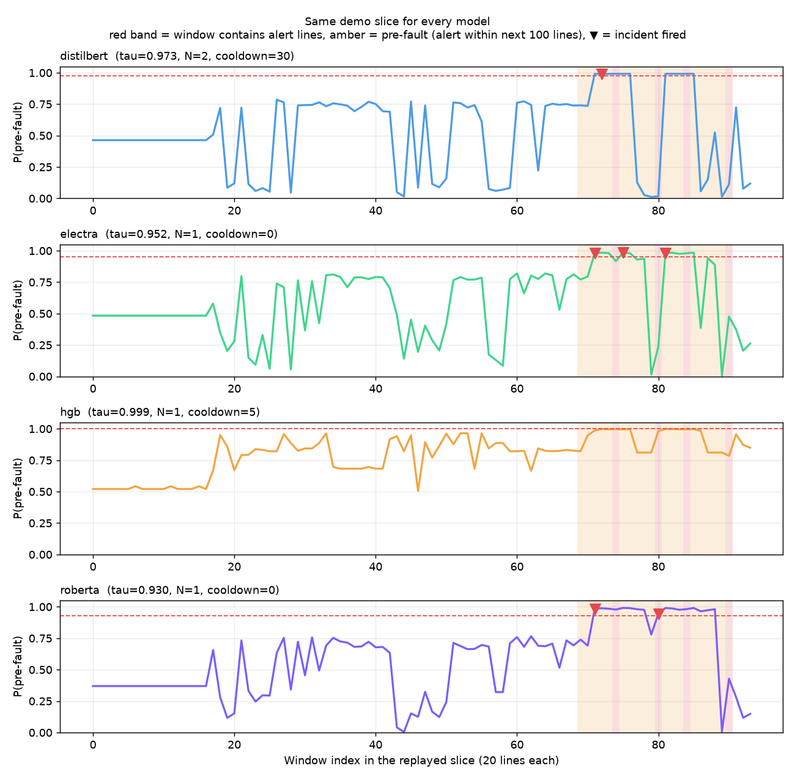
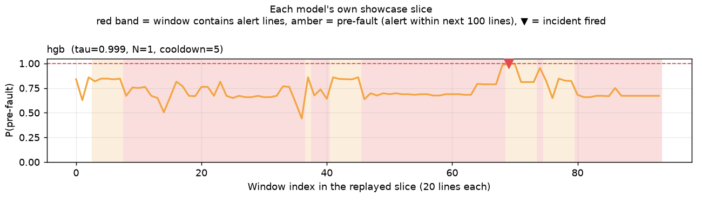

# Detailed model comparison

Generated by `v2/compare_demo.py`. Part 1 is offline evaluation over the whole held-out test split (thresholds and gates tuned on val only). Part 2 replays slices of the test split through the real `daemon.py` once per model, with LLM incident cards; ground truth is used only afterwards, to score the runs. The selected model is **`roberta`** (Highest val PR-AUC (0.2586); no other model within 0.01).

## 1. The models

| Model | Family | Input | Size | Training | Train (min) | Peak VRAM (MB) | Inference (ms/window) |
|---|---|---|---|---|---|---|---|
| distilbert | distilbert-base-uncased | rendered template text (RLE), max_length 512 | 67M parameters | best epoch 1 of 2 (early stop) | 24.2 | 4220 | 15.1 |
| electra | google/electra-base-discriminator | rendered template text (RLE), max_length 512 | 109M parameters | best epoch 1 of 2 (early stop) | 33.1 | 3578 | 21.0 |
| hgb | HistGradientBoostingClassifier | template-count vector + extras | 200 trees, 596 features | grid of 4, best max_iter=200, lr=0.05 | 0.9 | CPU only | 4.5 |
| roberta | FacebookAI/roberta-base | rendered template text (RLE), max_length 512 | 125M parameters | best epoch 1 of 2 (early stop) | 47.5 | 3803 | 24.1 |

## 2. Window-level metrics on the test split

At each model's val-chosen threshold (the lowest threshold whose val precision >= 0.8 (i.e. the highest val recall at that precision)).

| Model | val PR-AUC | tau* | Precision | Recall | F1 | PR-AUC | ROC-AUC | TP | FP | FN |
|---|---|---|---|---|---|---|---|---|---|---|
| distilbert | 0.240 | 0.9733 | 0.946 | 0.170 | 0.288 | 0.378 | 0.859 | 212 | 12 | 1038 |
| electra | 0.217 | 0.9524 | 0.954 | 0.150 | 0.259 | 0.431 | 0.855 | 187 | 9 | 1063 |
| hgb | 0.213 | 0.9990 | 1.000 | 0.012 | 0.024 | 0.363 | 0.911 | 15 | 0 | 1235 |
| roberta | 0.259 | 0.9302 | 0.964 | 0.303 | 0.461 | 0.473 | 0.867 | 379 | 14 | 871 |

### Precision / recall trade-off

Threshold chosen on val as the lowest one reaching each val precision target, then measured once on test. Shows how much recall each model keeps when pushed to high precision.

| Model | Val precision target | Reached on val | tau | Test precision | Test recall | TP | FP |
|---|---|---|---|---|---|---|---|
| distilbert | 0.5 | True | 0.9607 | 0.935 | 0.185 | 231 | 16 |
| distilbert | 0.8 | True | 0.9733 | 0.946 | 0.170 | 212 | 12 |
| distilbert | 0.9 | False | 0.9918 | 0.000 | 0.000 | 0 | 0 |
| electra | 0.5 | True | 0.9462 | 0.954 | 0.150 | 188 | 9 |
| electra | 0.8 | True | 0.9524 | 0.954 | 0.150 | 187 | 9 |
| electra | 0.9 | True | 0.9829 | 0.986 | 0.058 | 73 | 1 |
| hgb | 0.5 | True | 0.9980 | 1.000 | 0.057 | 71 | 0 |
| hgb | 0.8 | True | 0.9990 | 1.000 | 0.012 | 15 | 0 |
| hgb | 0.9 | True | 0.9993 | 1.000 | 0.001 | 1 | 0 |
| roberta | 0.5 | True | 0.7869 | 0.911 | 0.327 | 409 | 40 |
| roberta | 0.8 | True | 0.9302 | 0.964 | 0.303 | 379 | 14 |
| roberta | 0.9 | True | 0.9859 | 0.969 | 0.101 | 126 | 4 |

## 3. Incident-level metrics on the test split

The daemon gate replayed over the whole test stream. *Before fault* = an episode starts within the next 100 lines (the only kind credited); *late* = fired while a fault was already under way.

| Model | N | Cooldown | Incidents | Before fault | Late | False alarm | Incident precision | Faults warned | Faults | Episode recall | Lead median (s) |
|---|---|---|---|---|---|---|---|---|---|---|---|
| distilbert | 2 | 30 | 52 | 30 | 17 | 5 | 0.577 | 30 | 218 | 0.138 | 11.0 |
| electra | 1 | 0 | 115 | 52 | 58 | 5 | 0.452 | 51 | 218 | 0.234 | 12.0 |
| hgb | 1 | 5 | 17 | 12 | 5 | 0 | 0.706 | 12 | 218 | 0.055 | 12.0 |
| roberta | 1 | 0 | 105 | 36 | 62 | 7 | 0.343 | 35 | 218 | 0.161 | 12.0 |

## 4. Best model per metric

| Metric | Best | Value |
|---|---|---|
| Val PR-AUC (selection metric) | `roberta` | 0.259 |
| Test PR-AUC | `roberta` | 0.473 |
| Test ROC-AUC | `hgb` | 0.911 |
| Test window precision | `hgb` | 1.000 |
| Test window recall | `roberta` | 0.303 |
| Test window F1 | `roberta` | 0.461 |
| Test incident precision | `hgb` | 0.706 |
| Test episode recall | `electra` | 0.234 |
| Inference speed (ms/window) | `hgb` | 4.481 |
| Training time (min) | `hgb` | 0.945 |

## 5. Live daemon runs - same demo slice for every model

Every model replays the same slice (the selected model's demo slice) with its own tau / N / cooldown. Precision/recall in this section cover one short slice and are anecdotal; sections 2-3 are the real measure.

| Model | Slice (test lines) | Windows | Windows >= tau | Incidents | Before fault | Late | False alarm | Warning lead (lines) | Warning lead (s) | Mean conf, normal | Mean conf, pre-fault | Detect ms (median) | LLM s (median) | Cards parsed |
|---|---|---|---|---|---|---|---|---|---|---|---|---|---|---|
| distilbert | 4,591,434-4,593,333 | 94 | 11 | 1 | 1 | 0 | 0 | 39 | 6 | 0.490 | 0.628 | 10.7 | 2.5 | 1 |
| electra | 4,591,434-4,593,333 | 94 | 10 | 3 | 2 | 1 | 0 | 59 | 9 | 0.526 | 0.806 | 21.4 | 3.0 | 3 |
| hgb | 4,591,434-4,593,333 | 94 | 0 | 0 | 0 | 0 | 0 | - | - | 0.752 | 0.921 | 1.4 | - | 0 |
| roberta | 4,591,434-4,593,333 | 94 | 17 | 2 | 1 | 1 | 0 | 59 | 9 | 0.471 | 0.887 | 22.0 | 2.5 | 2 |

## 6. Live daemon runs - each model's own showcase slice

A showcase slice is a test fault that this model's gate warned about offline (chosen with ground truth). Shown so every model can be demoed firing; not a measure of performance.

| Model | Slice (test lines) | Windows | Windows >= tau | Incidents | Before fault | Late | False alarm | Warning lead (lines) | Warning lead (s) | Mean conf, normal | Mean conf, pre-fault | Detect ms (median) | LLM s (median) | Cards parsed |
|---|---|---|---|---|---|---|---|---|---|---|---|---|---|---|
| hgb | 4,258,214-4,260,108 | 94 | 1 | 1 | 1 | 0 | 0 | 94 | 14 | 0.776 | 0.842 | 1.5 | 2.7 | 1 |

## 7. Incident cards written during the runs

LLM-generated summaries (`llama3.2:3b`), not verified diagnoses. Verdict from ground truth.

- **distilbert**, shared slice, window 72, confidence 0.991, before fault, LLM 2.5 s - *high* / KERNEL: Repeated kernel fatal errors indicate potential hardware failure on the node. Action: Run a system reboot to isolate and diagnose the issue.
- **electra**, shared slice, window 71, confidence 0.981, before fault, LLM 3.2 s - *high* / KERNEL: Repeated kernel error messages indicate potential hardware failure on the node. Action: Run a system reboot and inspect the node for physical damage or issues.
- **electra**, shared slice, window 75, confidence 0.984, before fault, LLM 3.0 s - *high* / MEMORY: Repeated memory manager errors indicate potential memory degradation on the node. Action: Run a memory diagnostic on the affected node and flag it for service.
- **electra**, shared slice, window 81, confidence 0.982, late (fault already started), LLM 2.9 s - *high* / KERNEL: Repeated kernel fatal errors indicate a potential hardware issue with the system. Action: Run a full system reboot to isolate and diagnose the issue.
- **roberta**, shared slice, window 71, confidence 0.984, before fault, LLM 2.7 s - *high* / KERNEL: Repeated kernel error messages indicate potential hardware failure on the node. Action: Run a system reboot and inspect the node for physical damage.
- **roberta**, shared slice, window 80, confidence 0.945, late (fault already started), LLM 2.3 s - *critical* / KERNEL: Repeated kernel fatal errors indicate a potential hardware issue with the system. Action: Immediately power cycle the affected node to prevent further damage.
- **hgb**, own slice, window 69, confidence 0.999, before fault, LLM 2.7 s - *high* / KERNEL: Repeated kernel errors indicate potential hardware failure or configuration issue. Action: Run a system reboot and check for any recent configuration changes.
